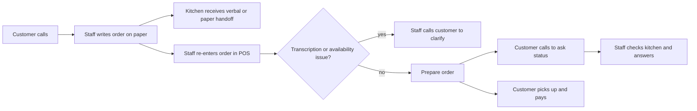
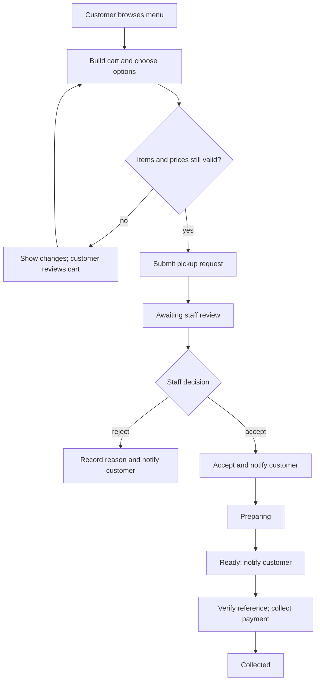

# Process Flows

## As-is: phone order and manual re-entry

**Observed problem hypothesis:** handwritten capture, re-entry, and status calls add handoffs. This is a hypothesis to validate with staff observation, not measured evidence.

## To-be: web request with explicit staff decision

Staff acceptance is a deliberate control: successful submission means the request was received, not that the restaurant has committed to fulfil it.
