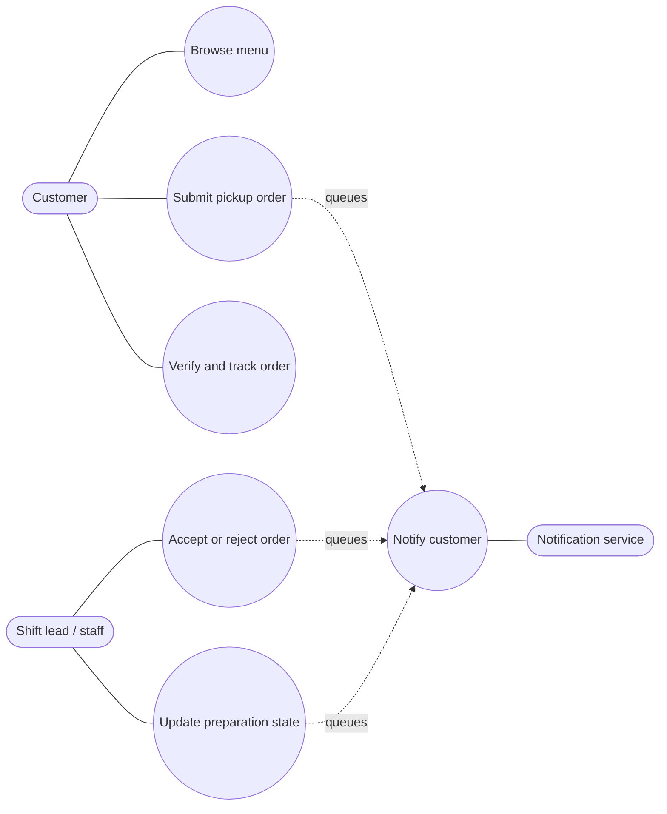
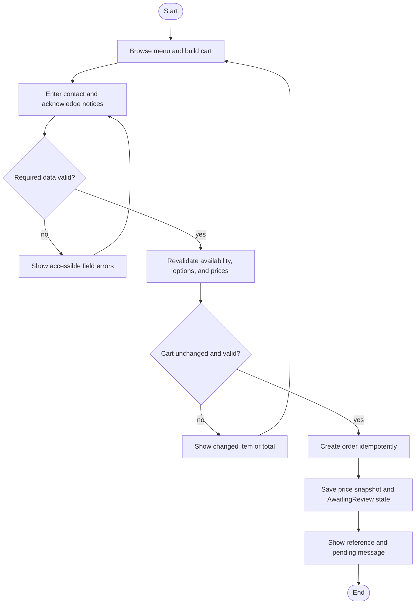
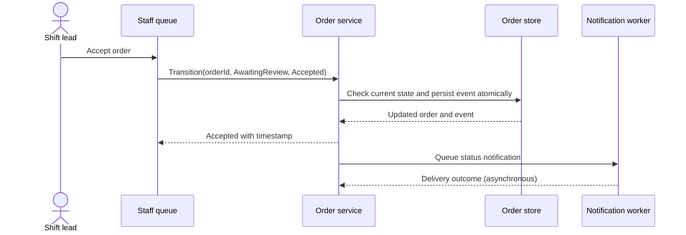

# UML Views

## Use-case view

## Activity view: submit order

## Sequence view: staff decision

The expected-state check prevents a stale staff screen from silently overwriting a decision made by another staff member. Notification delivery is asynchronous and does not roll back the business state.
